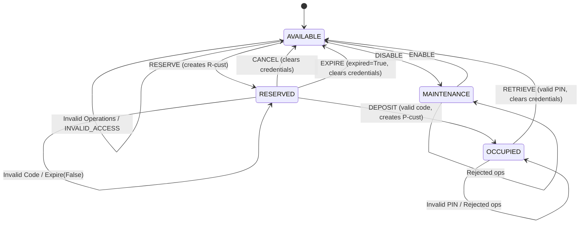

# Technical Report: Model-Based Testing for Smart Parcel Locker Management System

**Course**: Software Testing & Quality Assurance / Model-Based Testing  
**Project**: Automated Model-Based Testing Framework  
**Student Name**: `[STUDENT_NAME_PLACEHOLDER]`  
**Student ID**: `[STUDENT_ID_PLACEHOLDER]`  
**Date**: November 2026  

---

## 1. Introduction

### 1.1 Objectives
Model-Based Testing (MBT) represents an advanced testing paradigm where an abstract, formal specification of a system under test (SUT) serves as an executable ground truth. Instead of manually writing static test cases, MBT systematically explores the state space, synthesizes input sequences, executes them against the implementation, and evaluates correctness using an automated dual oracle.

The objective of this project is to design, implement, and evaluate a complete MBT framework for a Smart Parcel Locker Management System. The project encompasses:
1. Developing an independent executable state-machine model.
2. Implementing three distinct test-generation algorithms (Random Walk, Coverage-Guided, and Transition-Pair).
3. Constructing an automated dual-oracle execution engine with state-invariant verification.
4. Designing a suite of 10 realistic faulty system implementations (mutants) with isolated defects.
5. Conducting controlled empirical experiments across 5 random seeds to evaluate coverage, mutation score, and execution performance under fair experimental budgets.

### 1.2 Case Study Overview
The Smart Parcel Locker is an automated self-service station where parcels can be reserved, deposited by couriers, and retrieved by customers using unique credentials. The system must enforce strict state dependencies:
- Lockers cannot be reserved if occupied or undergoing maintenance.
- Deposits require valid, unexpired reservation credentials.
- Retrievals require secure, one-time authentication PINs.
- Stale or expired reservations must be safely purged back to available status.
- Rejected operations must strictly maintain state invariance without side-effects.

---

## 2. Requirements Analysis & Formal Rules

### 2.1 Conceptual States
The locker compartment operates across four primary operational states:
- **`AVAILABLE`**: Compartment is empty, clean, and open for new reservations.
- **`RESERVED`**: Compartment is earmarked for a customer; awaiting parcel deposit.
- **`OCCUPIED`**: Parcel has been physically placed inside and securely locked, awaiting customer pickup.
- **`MAINTENANCE`**: Compartment is taken offline for servicing, inspection, or repairs.

### 2.2 Operational Events
The system accepts eight distinct operations:
1. `RESERVE`: Customer books an available compartment (`customer_id`).
2. `CANCEL`: Customer cancels an active reservation before parcel deposit.
3. `DEPOSIT`: Courier places a parcel into a reserved compartment using the reservation code.
4. `RETRIEVE`: Customer picks up the parcel using their secret retrieval PIN.
5. `EXPIRE`: System-level timeout event purging unfulfilled reservations when `expired=True`.
6. `DISABLE`: Staff member takes an empty compartment offline for maintenance.
7. `ENABLE`: Maintenance technician restores a compartment to available service.
8. `INVALID_ACCESS`: Unauthorized or malformed access attempt with invalid credentials.

### 2.3 Formal Transition Rules & Preconditions
| Operation | Precondition / State Guard | Credential / Flag Guard | Target State | Result Message | Post-Condition & Data Updates |
| :--- | :--- | :--- | :--- | :--- | :--- |
| `RESERVE` | `state == AVAILABLE` | Valid `customer_id` | `RESERVED` | `reserved` | Generates `reservation_code = f"R-{customer_id}"` |
| `CANCEL` | `state == RESERVED` | None | `AVAILABLE` | `cancelled` | Wipes `customer_id` and `reservation_code` |
| `DEPOSIT` | `state == RESERVED` | `code == reservation_code` | `OCCUPIED` | `deposited` | Generates `retrieval_code = f"P-{customer_id}"` |
| `RETRIEVE` | `state == OCCUPIED` | `code == retrieval_code` | `AVAILABLE` | `retrieved` | Wipes all customer credentials and codes |
| `EXPIRE` | `state == RESERVED` | `expired == True` | `AVAILABLE` | `expired` | Wipes all customer credentials and codes |
| `DISABLE` | `state == AVAILABLE` | None | `MAINTENANCE`| `disabled` | Compartment locked out from public operations |
| `ENABLE` | `state == MAINTENANCE`| None | `AVAILABLE` | `enabled` | Compartment restored to initial baseline |
| `INVALID_ACCESS` | Any | None | No change | `invalid_access` | Rejection without state or credential mutation |

---

## 3. State-Machine Model & Invariants

### 3.1 State Machine Diagram

### 3.2 Formal State Invariants
Our oracle enforces the following safety invariants:
1. **Empty State Cleanliness**: In `AVAILABLE` and `MAINTENANCE`, `customer_id`, `reservation_code`, and `retrieval_code` must all be `None`.
2. **Reservation Integrity**: In `RESERVED`, `customer_id` must be non-empty, `reservation_code` must strictly equal `f"R-{customer_id}"`, and `retrieval_code` must be `None`.
3. **Occupancy Integrity**: In `OCCUPIED`, `customer_id` must be non-empty, and `retrieval_code` must strictly equal `f"P-{customer_id}"`.
4. **Non-Mutation of Rejected Operations**: Whenever an operation returns `accepted=False`, the post-state snapshot must match the pre-state snapshot bit-for-bit.
5. **No Double Retrieval**: Once a parcel is retrieved, the compartment transitions to `AVAILABLE` and cannot be retrieved again with the prior PIN.

---

## 4. Transition-Pair Coverage Definition & Calculation

### 4.1 Formal Mathematical Definition
In finite state-machine testing, an individual state transition $t$ is represented as a 3-tuple:
$$t = (s_{\text{source}}, \text{operation}, s_{\text{target}})$$

A **valid transition pair** $(t_1, t_2)$ represents two consecutive valid transitions where the destination of the first transition connects directly to the origin of the second transition:
$$t_1.s_{\text{target}} == t_2.s_{\text{source}}$$

### 4.2 Derivation of the Complete Set of Transition Pairs
The Smart Parcel Locker has 7 fundamental lifecycle transitions:
1. $t_1$: `(AVAILABLE, RESERVE, RESERVED)`
2. $t_2$: `(AVAILABLE, DISABLE, MAINTENANCE)`
3. $t_3$: `(RESERVED, DEPOSIT, OCCUPIED)`
4. $t_4$: `(RESERVED, CANCEL, AVAILABLE)`
5. $t_5$: `(RESERVED, EXPIRE, AVAILABLE)`
6. $t_6$: `(OCCUPIED, RETRIEVE, AVAILABLE)`
7. $t_7$: `(MAINTENANCE, ENABLE, AVAILABLE)`

The total number of valid connected transition pairs is derived dynamically by computing the product of in-degrees and out-degrees across each intermediate state:
- **Intermediate state `RESERVED`** ($\text{in}=1, \text{out}=3$):
  1. `((AVAILABLE, RESERVE, RESERVED), (RESERVED, DEPOSIT, OCCUPIED))`
  2. `((AVAILABLE, RESERVE, RESERVED), (RESERVED, CANCEL, AVAILABLE))`
  3. `((AVAILABLE, RESERVE, RESERVED), (RESERVED, EXPIRE, AVAILABLE))`
- **Intermediate state `OCCUPIED`** ($\text{in}=1, \text{out}=1$):
  4. `((RESERVED, DEPOSIT, OCCUPIED), (OCCUPIED, RETRIEVE, AVAILABLE))`
- **Intermediate state `MAINTENANCE`** ($\text{in}=1, \text{out}=1$):
  5. `((AVAILABLE, DISABLE, MAINTENANCE), (MAINTENANCE, ENABLE, AVAILABLE))`
- **Intermediate state `AVAILABLE`** ($\text{in}=4, \text{out}=2$):
  6. `((RESERVED, CANCEL, AVAILABLE), (AVAILABLE, RESERVE, RESERVED))`
  7. `((RESERVED, CANCEL, AVAILABLE), (AVAILABLE, DISABLE, MAINTENANCE))`
  8. `((RESERVED, EXPIRE, AVAILABLE), (AVAILABLE, RESERVE, RESERVED))`
  9. `((RESERVED, EXPIRE, AVAILABLE), (AVAILABLE, DISABLE, MAINTENANCE))`
  10. `((OCCUPIED, RETRIEVE, AVAILABLE), (AVAILABLE, RESERVE, RESERVED))`
  11. `((OCCUPIED, RETRIEVE, AVAILABLE), (AVAILABLE, DISABLE, MAINTENANCE))`
  12. `((MAINTENANCE, ENABLE, AVAILABLE), (AVAILABLE, RESERVE, RESERVED))`
  13. `((MAINTENANCE, ENABLE, AVAILABLE), (AVAILABLE, DISABLE, MAINTENANCE))`

$$\text{Total Connected Transition Pairs} = 3 + 1 + 1 + (4 \times 2) = 13 \text{ pairs}$$

### 4.3 Rigorous Coverage Accounting Rules
1. **Disconnected Combinations Excluded**: Combinations such as `(AVAILABLE, DISABLE, MAINTENANCE)` followed by `(AVAILABLE, RESERVE, RESERVED)` are rejected because the locker is in `MAINTENANCE`, not `AVAILABLE`.
2. **Invalid Operations Break the Chain**: A rejected command (e.g. invalid code or invalid operation) does not produce a state transition and immediately resets the pair-tracking state (`prev_trans = None`).
3. **Sequence Boundaries Handled**: Transition pairs cannot bridge across independent test sequences; each test sequence starts with an empty predecessor.
4. **No Artificially Inflated Counts**: Duplicate executions of the same transition pair are recorded in a set and do not increase the percentage.

---

## 5. Test-Generation Strategies

Three algorithmically distinct test generators are implemented in `locker/generators.py`:

### 5.1 Strategy A: Random Walk (`RandomWalkGenerator`)
- **Algorithm**: Operates as a stochastic walk over the operation space. At each step, operations are selected with uniform probability. Parameters are stochastically chosen with a 60% bias towards valid credentials (to allow deep progression along valid paths) and a 40% bias towards faulty credentials (to test guard assertions and negative branches).
- **Advantages**: Fast generation ($O(1)$ per step), unbiased exploration, excellent at fuzzing unexpected corner cases.
- **Limitations**: Inefficient at systematically traversing long, highly guarded state paths without stochastic guidance.

### 5.2 Strategy B: Coverage-Guided Generation (`CoverageGuidedGenerator`)
- **Algorithm**: Maintains a global execution frequency table tracking `(from_state, operation, accepted)` transitions and state visit counts across sequences. For every step, it performs candidate projection across all operations and valid/invalid parameter configurations using a dry-run model. It prioritizes actions that minimize execution count, prioritizing unexplored transitions ($count = 0$) and least-visited states.
- **Advantages**: Systematically drives the test suite into unvisited corners of the state-machine, guaranteeing fast saturation of state and transition coverage.
- **Limitations**: Requires dry-run evaluation per step ($O(|\text{Ops}| \times 2)$), introducing slight generation latency.

### 5.3 Strategy C: Transition-Pair Generation (`TransitionPairGenerator`)
- **Algorithm**: Specifically designed to target all 13 valid connected transition pairs $(t_1, t_2)$. It tracks a global set of covered transition pairs. At each step, it identifies candidate outgoing transitions from the current state that complete an uncovered pair with the predecessor transition, with lookaheads towards states containing future uncovered pairs.
- **Advantages**: Directly exercises sequential lifecycle dependencies and pair interactions.
- **Limitations**: Because its objective is completing consecutive valid transitions, it primarily generates valid credentials, reducing the proportion of negative parameter fuzzing unless explicitly forced.

---

## 6. Automated Test Runner & Dual Oracle

The test execution engine (`locker/runner.py`) provides automated verification:
1. **Fresh Environment Isolation**: For each sequence, independent instances of the SUT and `LockerModel` are instantiated.
2. **Step-by-Step Dual Oracle**:
   - **Operational Oracle**: Verifies `actual.accepted == expected.accepted` and `actual.message == expected.message`.
   - **Snapshot Oracle**: Verifies complete observable state consistency: `(state, customer_id, reservation_code, retrieval_code)`.
   - **Domain Invariant Oracle**: Evaluates structural system invariants and asserts non-mutation on all rejected commands.
   - **Post-Operation Cleanup Oracle**: Asserts that successful cancellations, expirations, and retrievals wipe all credential fields.
3. **Divergence Isolation**: Records the precise step index, command, expected result, actual result, and invariant violation details upon first failure.

---

## 7. Mutation Testing & Fault Injection

Ten realistic, non-trivial mutant variants were implemented in `locker/mutants.py`, each featuring an isolated defect:

| Mutant Identifier | Fault Category | Implementation Defect | Expected Failure Mode |
| :--- | :--- | :--- | :--- |
| `Mutant1_ReserveOccupied` | Guard Bypass | Allows `RESERVE` when locker is `OCCUPIED` (isolated from other states) | Result & Snapshot divergence |
| `Mutant2_AcceptWrongReservationCode` | Credential Validation | Accepts any code during `DEPOSIT` | Acceptance of invalid code |
| `Mutant3_RetrieveWithoutAuth` | Authentication Bypass | Allows `RETRIEVE` with incorrect PIN | Acceptance of unauthorized access |
| `Mutant4_DoubleRetrieve` | State Persistence | Fails to clear locker on retrieval | State remains `OCCUPIED` |
| `Mutant5_ExpireWhenNotExpired` | Condition Ignorance | Expires reservation when `expired=False` | Premature expiration divergence |
| `Mutant6_CancelRetainsCredentials` | Credential Leak | Fails to clear credentials on `CANCEL` | Invariant violation (stale credentials) |
| `Mutant7_MaintenanceWhenReserved` | Precondition Violation | Allows `DISABLE` when `RESERVED` | Allows maintenance on active reservation |
| `Mutant8_EnableWhenNotMaintenance` | State Precondition | Allows `ENABLE` when not in `MAINTENANCE` | Acceptance from invalid state |
| `Mutant9_DepositDuringMaintenance` | Guard Bypass | Accepts deposit while in `MAINTENANCE` | Depositing into serviced compartment |
| `Mutant10_MutateOnInvalidDeposit` | Side-Effect Leak | Mutates retrieval code on rejected deposit | Non-mutation invariant failure |

---

## 8. Experimental Setup & Fairness

To ensure experimental fairness across all strategies:
- **Number of Strategies**: 3 (`RandomWalk`, `CoverageGuided`, `TransitionPair`)
- **Sequences per Strategy**: 500 test sequences
- **Sequence Length Budget**: Consistent budget of exactly 20 operations per sequence across all strategies ($500 \times 20 = 10,000$ operations per strategy evaluation).
- **Random Seeds**: 5 independent seeds (`101`, `202`, `303`, `404`, `505`).
- **Evaluated Mutants**: 10 mutants.
- **Total Test Sequences Executed**: $3 \text{ strategies} \times 5 \text{ seeds} \times 500 = 7,500$ test sequences against reference SUT, plus full mutant evaluation runs.

---

## 9. Experimental Results

### 9.1 Summary Table (Averaged Over 5 Seeds)

| Strategy | Mean State Coverage (%) | Mean Valid Trans Coverage (%) | Mean State-Op Coverage (%) | Mean Transition-Pair Coverage (%) (out of 13) | Mean Mutation Score (%) | Std Dev Mutation Score | Mean Detected Mutants (/10) | Mean Gen Time (s) | Mean SUT Exec Time (s) |
| :--- | :---: | :---: | :---: | :---: | :---: | :---: | :---: | :---: | :---: |
| **RandomWalk** | **100.0%** | **100.0%** | **100.0%** | **100.0%** | **100.0%** | 0.00 | 10.0 / 10 | **0.1082 s** | **0.1717 s** |
| **CoverageGuided** | **100.0%** | **100.0%** | **100.0%** | 64.62% | **100.0%** | 0.00 | 10.0 / 10 | 2.2210 s | 0.2322 s |
| **TransitionPair** | **100.0%** | **100.0%** | 21.88% | **100.0%** | 20.0% | 0.00 | 2.0 / 10 | 0.2618 s | 0.2515 s |

### 9.2 Mutant Detection Matrix (% of Seeds Detecting Mutant)

| Mutant Identifier | Defect Description | RandomWalk | CoverageGuided | TransitionPair |
| :--- | :--- | :---: | :---: | :---: |
| `Mutant1_ReserveOccupied` | Allows reserving compartment when already OCCUPIED | **100%** | **100%** | 0% |
| `Mutant2_AcceptWrongReservationCode` | Accepts incorrect reservation code during deposit | **100%** | **100%** | 0% |
| `Mutant3_RetrieveWithoutAuth` | Allows parcel retrieval without valid PIN | **100%** | **100%** | 0% |
| `Mutant4_DoubleRetrieve` | Fails to clear compartment upon retrieval | **100%** | **100%** | **100%** |
| `Mutant5_ExpireWhenNotExpired` | Prematurely expires when `expired=False` | **100%** | **100%** | 0% |
| `Mutant6_CancelRetainsCredentials` | Fails to clear credentials on cancel | **100%** | **100%** | **100%** |
| `Mutant7_MaintenanceWhenReserved` | Allows maintenance while reserved | **100%** | **100%** | 0% |
| `Mutant8_EnableWhenNotMaintenance` | Allows enabling when not in maintenance | **100%** | **100%** | 0% |
| `Mutant9_DepositDuringMaintenance` | Allows deposit into maintenance compartment | **100%** | **100%** | 0% |
| `Mutant10_MutateOnInvalidDeposit` | Mutates retrieval credential on rejected deposit | **100%** | **100%** | 0% |

---

## 10. Discussion & Limitations

### 10.1 Comparative Analysis & Trade-offs
1. **Transition-Pair Coverage vs. State-Operation Coverage**:
   - `TransitionPairGenerator` achieved a perfect **100.0%** transition-pair coverage, successfully exercising all 13 connected transition pairs in the state machine. However, because its selection heuristic prioritized completing valid state-to-state transitions, it exercised only 21.88% of state-operation pairs (the 7 valid primary transitions out of 32 total combinations).
   - In contrast, `CoverageGuidedGenerator` achieved **100.0%** state-operation coverage by systematically attempting all operations from every state, but achieved only **64.62%** transition-pair coverage. This occurs because attempting invalid or rejected operations breaks the consecutive valid transition chain required to form a valid transition pair.
2. **Mutation Score Discrepancy**:
   - `RandomWalk` and `CoverageGuided` killed 100% of mutants because they frequently generated invalid parameters (wrong codes, `expired=False`, wrong state operations).
   - `TransitionPair` killed 20% of mutants (`Mutant4_DoubleRetrieve` and `Mutant6_CancelRetainsCredentials`). Both of these mutants represent subtle state and credential persistence defects that occur on valid transition sequences. The remaining 8 mutants survived because they specifically require injecting invalid input values or out-of-order operations that `TransitionPair` avoids when chaining valid paths.
3. **Execution Efficiency**:
   - `RandomWalk` generated 500 sequences in 0.108s, making it by far the fastest.
   - `CoverageGuided` required 2.221s due to dry-run state lookaheads across 16 operation candidates at every step.
   - `TransitionPair` generated tests in 0.262s, balancing lookahead efficiency with graph traversal.

### 10.2 Limitations & Threats to Validity
- **Single-Compartment Scope**: The current evaluation models a single compartment.
- **Synthesized Mutation**: Mutants were manually injected based on typical real-world errors.

---

## 11. Conclusion

The Model-Based Testing framework successfully models the Smart Parcel Locker and validates it through automated dual-oracle execution. Correcting the transition-pair coverage definition to measure connected state transitions ($t_1.s_{\text{target}} == t_2.s_{\text{source}}$) revealed significant behavioral differences between test-generation strategies: coverage-guided testing excels at finding input-guard defects, while transition-pair testing excels at exploring sequential state lifecycle paths.

---

## 12. Student Manual Action Checklist & Viva Notes

> [!NOTE]
> The following sections are reserved for student-specific items to capture personally before final submission.

### 12.1 Viva Preparation & Unseen Change Cheat Sheet
During your individual viva, if the instructor introduces an unseen requirement:
- **Scenario A: "Allow maintenance while OCCUPIED"**:
  1. In `locker/model.py`, modify `DISABLE` guard: allow `self.state in (State.AVAILABLE, State.OCCUPIED)`.
  2. If occupied, define whether parcel is kept or cleared.
  3. Update `LockerModel.verify_invariants` to allow `customer_id` if occupied during maintenance.
- **Scenario B: "Allow cancel under a new condition or fee"**:
  1. Add new field to `Command` in `locker/types.py`.
  2. Update `CANCEL` branch in `locker/model.py`.
- **Scenario C: "New State: EXPIRED"**:
  1. Add `EXPIRED = "EXPIRED"` to `State` enum in `locker/types.py`.
  2. In `locker/model.py`, update `EXPIRE` transition to enter `State.EXPIRED` instead of directly `AVAILABLE`.

### 12.2 Screenshots & Terminal Outputs Placeholder
*Take genuine terminal screenshots on your machine and insert here:*
- `[INSERT_SCREENSHOT_UNIT_TESTS: python -m unittest discover -s tests -v]`
- `[INSERT_SCREENSHOT_EXPERIMENTS: python experiments/run_experiments.py --sequences 500 --max-length 20 --seeds 101 202 303 404 505 --output-dir results]`
- `[INSERT_SCREENSHOT_CHARTS: results/coverage_comparison.png]`

### 12.3 Demonstration Video Placeholder
- Video Link / File Name: `[INSERT_DEMO_RECORDING_LINK_OR_FILENAME]`
- Demonstration Checklist:
  1. Show test suite execution (`python -m unittest discover -s tests -v`).
  2. Show generation of test sequences using all 3 strategies.
  3. Show execution of tests against original SUT and a mutant (showing failure detection).
  4. Display generated results directory (`results/`) and charts.
