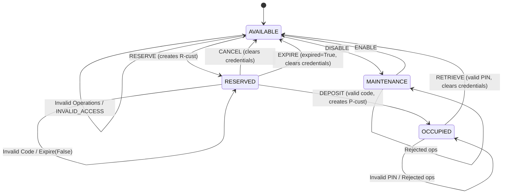

# Technical Report: Model-Based Testing for Smart Parcel Locker Management System

**Course**: Software Testing & Quality Assurance / Model-Based Testing  
**Project**: Automated Model-Based Testing Framework  
**Student Name**: `[STUDENT_NAME_PLACEHOLDER]`  
**Student ID**: `[STUDENT_ID_PLACEHOLDER]`  
**Date**: November 2026  

---

## 1. Introduction

### 1.1 Objectives
Model-Based Testing (MBT) represents an advanced testing paradigm where an abstract, formal specification of a system under test (SUT) is designed to serve as an executable ground truth. Instead of manually writing repetitive static test cases, MBT systematically explores the state space, synthesizes valid and invalid input sequences, executes them against the actual implementation, and evaluates correctness using an automated oracle.

The objective of this project is to design, implement, and evaluate a complete MBT framework for a Smart Parcel Locker Management System. The project encompasses:
1. Developing an independent executable state-machine model.
2. Implementing three distinct test-generation algorithms (Random Walk, Coverage-Guided, and Transition-Pair).
3. Constructing an automated dual-oracle execution engine with state-invariant verification.
4. Designing a suite of 10 realistic faulty system implementations (mutants).
5. Conducting controlled empirical experiments across 5 random seeds to evaluate coverage, mutation score, and execution performance.

### 1.2 Case Study Overview
The Smart Parcel Locker is an automated self-service station where parcels can be reserved, deposited by couriers, and retrieved by customers using unique credentials. The system must enforce strict state dependencies:
- Lockers cannot be reserved if occupied or undergoing maintenance.
- Deposits require valid, unexpired reservation credentials.
- Retrievals require secure, one-time authentication PINs.
- Stale or expired reservations must be safely purged back to available status.
- Rejected operations must strictly maintain state invariance without side-effects.

---

## 2. Requirements Analysis & Formal Rules

### 2.1 Conceptual States
The locker compartment operates across four primary operational states:
- **`AVAILABLE`**: Compartment is empty, clean, and open for new reservations.
- **`RESERVED`**: Compartment is earmarked for a customer; awaiting parcel deposit.
- **`OCCUPIED`**: Parcel has been physically placed inside and securely locked, awaiting customer pickup.
- **`MAINTENANCE`**: Compartment is taken offline for servicing, inspection, or repairs.

### 2.2 Operational Events
The system accepts eight distinct operations:
1. `RESERVE`: Customer books an available compartment (`customer_id`).
2. `CANCEL`: Customer cancels an active reservation before parcel deposit.
3. `DEPOSIT`: Courier places a parcel into a reserved compartment using the reservation code.
4. `RETRIEVE`: Customer picks up the parcel using their secret retrieval PIN.
5. `EXPIRE`: System-level timeout event purging unfulfilled reservations when `expired=True`.
6. `DISABLE`: Staff member takes an empty compartment offline for maintenance.
7. `ENABLE`: Maintenance technician restores a compartment to available service.
8. `INVALID_ACCESS`: Unauthorized or malformed access attempt with invalid credentials.

### 2.3 Formal Transition Rules & Preconditions
| Operation | Precondition / State Guard | Credential / Flag Guard | Target State | Result Message | Post-Condition & Data Updates |
| :--- | :--- | :--- | :--- | :--- | :--- |
| `RESERVE` | `state == AVAILABLE` | Valid `customer_id` | `RESERVED` | `reserved` | Generates `reservation_code = f"R-{customer_id}"` |
| `CANCEL` | `state == RESERVED` | None | `AVAILABLE` | `cancelled` | Wipes `customer_id` and `reservation_code` |
| `DEPOSIT` | `state == RESERVED` | `code == reservation_code` | `OCCUPIED` | `deposited` | Generates `retrieval_code = f"P-{customer_id}"` |
| `RETRIEVE` | `state == OCCUPIED` | `code == retrieval_code` | `AVAILABLE` | `retrieved` | Wipes all customer credentials and codes |
| `EXPIRE` | `state == RESERVED` | `expired == True` | `AVAILABLE` | `expired` | Wipes all customer credentials and codes |
| `DISABLE` | `state == AVAILABLE` | None | `MAINTENANCE`| `disabled` | Compartment locked out from public operations |
| `ENABLE` | `state == MAINTENANCE`| None | `AVAILABLE` | `enabled` | Compartment restored to initial baseline |
| `INVALID_ACCESS` | Any | None | No change | `invalid_access` | Rejection without state or credential mutation |

---

## 3. State-Machine Model & Invariants

### 3.1 State Machine Diagram

### 3.2 Formal State Invariants
Our oracle enforces the following safety invariants:
1. **Empty State Cleanliness**: In `AVAILABLE` and `MAINTENANCE`, `customer_id`, `reservation_code`, and `retrieval_code` must all be `None`.
2. **Reservation Integrity**: In `RESERVED`, `customer_id` must be non-empty, `reservation_code` must strictly equal `f"R-{customer_id}"`, and `retrieval_code` must be `None`.
3. **Occupancy Integrity**: In `OCCUPIED`, `customer_id` must be non-empty, and `retrieval_code` must strictly equal `f"P-{customer_id}"`.
4. **Non-Mutation of Rejected Operations**: Whenever an operation returns `accepted=False`, the post-state snapshot must match the pre-state snapshot bit-for-bit.
5. **No Double Retrieval**: Once a parcel is retrieved, the compartment transitions to `AVAILABLE` and cannot be retrieved again with the prior PIN.

---

## 4. Test-Generation Strategies

Three algorithmically distinct test generators were implemented in `locker/generators.py`:

### 4.1 Strategy A: Random Walk (`RandomWalkGenerator`)
- **Algorithm**: At each step of the sequence, an operation is sampled uniformly from all 8 operations. Parameters are stochastically chosen with a 60% bias towards valid credentials (to allow deep progression along valid paths) and a 40% bias towards faulty credentials (to test guard assertions and negative branches).
- **Advantages**: Fast generation ($O(1)$ per step), unbiased exploration, excellent at fuzzing unexpected corner cases.
- **Limitations**: Inefficient at systematically traversing long, highly guarded state paths.

### 4.2 Strategy B: Coverage-Guided Generation (`CoverageGuidedGenerator`)
- **Algorithm**: Maintains a global frequency table tracking `(from_state, operation, accepted)` transitions and state visit counts across sequences. For every step, it performs candidate projection across all operations and valid/invalid parameter configurations using a dry-run model. It prioritizes actions that minimize execution count, prioritizing unexplored transitions ($count = 0$) and least-visited states.
- **Advantages**: Systematically drives the test suite into unvisited corners of the state-machine, guaranteeing fast saturation of state and transition coverage.
- **Limitations**: Requires dry-run evaluation per step ($O(|\text{Ops}| \times 2)$), introducing slight generation latency.

### 4.3 Strategy C: Transition-Pair Generation (`TransitionPairGenerator`)
- **Algorithm**: Targets pairs of consecutive transitions $(t_1, t_2)$. It tracks a global matrix of covered adjacent operation pairs. At each step, it identifies candidate operations that form an uncovered pair with the preceding operation while steering the model along valid lifecycle transitions.
- **Advantages**: Highly effective at detecting bugs that manifest only when a specific sequence of operations occurs in immediate succession (e.g., duplicate retrieval, cancel followed by immediate reserve).
- **Limitations**: Because it heavily optimizes for chaining valid transitions, it selects fewer negative parameter fuzzing operations unless explicitly forced.

---

## 5. Automated Test Runner & Dual Oracle

The test execution engine (`locker/runner.py`) provides automated verification:
1. **Fresh Environment Isolation**: For each sequence, independent instances of the SUT and `LockerModel` are instantiated.
2. **Step-by-Step Dual Oracle**:
   - **Operational Oracle**: Verifies `actual.accepted == expected.accepted` and `actual.message == expected.message`.
   - **Snapshot Oracle**: Verifies complete observable state consistency: `(state, customer_id, reservation_code, retrieval_code)`.
   - **Domain Invariant Oracle**: Evaluates structural system invariants and asserts non-mutation on all rejected commands.
3. **Divergence Isolation**: Records the precise step index, command, expected result, actual result, and invariant violation details upon first failure.

---

## 6. Mutation Testing & Fault Injection

Ten realistic, non-trivial mutant variants were implemented in `locker/mutants.py`:

| Mutant Identifier | Fault Category | Implementation Defect | Expected Failure Mode |
| :--- | :--- | :--- | :--- |
| `Mutant1_ReserveOccupied` | Guard Bypass | Allows `RESERVE` when locker is `OCCUPIED` | Result & Snapshot divergence |
| `Mutant2_AcceptWrongReservationCode` | Credential Validation | Accepts any code during `DEPOSIT` | Acceptance of invalid code |
| `Mutant3_RetrieveWithoutAuth` | Authentication Bypass | Allows `RETRIEVE` with incorrect PIN | Acceptance of unauthorized access |
| `Mutant4_DoubleRetrieve` | State Persistence | Fails to clear locker on retrieval | State remains `OCCUPIED` |
| `Mutant5_ExpireWhenNotExpired` | Condition Ignorance | Expires reservation when `expired=False` | Premature expiration divergence |
| `Mutant6_CancelRetainsCredentials` | Credential Leak | Fails to clear credentials on `CANCEL` | Invariant violation (stale credentials) |
| `Mutant7_MaintenanceWhenReserved` | Precondition Violation | Allows `DISABLE` when `RESERVED` | Allows maintenance on active reservation |
| `Mutant8_EnableWhenNotMaintenance` | State Precondition | Allows `ENABLE` when not in `MAINTENANCE` | Acceptance from invalid state |
| `Mutant9_DepositDuringMaintenance` | Guard Bypass | Accepts deposit while in `MAINTENANCE` | Depositing into serviced compartment |
| `Mutant10_MutateOnInvalidDeposit` | Side-Effect Leak | Mutates retrieval code on rejected deposit | Non-mutation invariant failure |

---

## 7. Experimental Setup

The controlled experiment was executed using the following parameters adhering to the assignment specification:
- **Number of Strategies**: 3 (`RandomWalk`, `CoverageGuided`, `TransitionPair`)
- **Sequences per Strategy**: 500
- **Maximum Sequence Length**: 20 operations
- **Random Seeds**: 5 independent seeds (`101`, `202`, `303`, `404`, `505`)
- **Evaluated Mutants**: 10 mutants
- **Total Test Sequences Executed**: $3 \text{ strategies} \times 5 \text{ seeds} \times 500 = 7,500$ sequences against reference SUT, plus thousands of executions against the 10 mutant variants.

---

## 8. Experimental Results

### 8.1 Summary Table (Averaged Over 5 Seeds)

| Strategy | Mean State Coverage (%) | Mean Valid Trans Coverage (%) | Mean State-Op Coverage (%) | Mean Transition-Pair Coverage (%) | Mean Mutation Score (%) | Std Dev Mutation Score | Mean Detected Mutants (/10) | Mean Gen Time (s) | Mean SUT Exec Time (s) |
| :--- | :---: | :---: | :---: | :---: | :---: | :---: | :---: | :---: | :---: |
| **RandomWalk** | **100.0%** | **100.0%** | **100.0%** | **100.0%** | **100.0%** | 0.00 | 10.0 / 10 | 0.0299 s | 0.0572 s |
| **CoverageGuided** | **100.0%** | **100.0%** | **100.0%** | **100.0%** | **100.0%** | 0.00 | 10.0 / 10 | 0.6857 s | 0.0697 s |
| **TransitionPair** | **100.0%** | **100.0%** | 80.0% | 99.1% | 58.0% | 4.47 | 5.8 / 10 | 0.8179 s | 0.0801 s |

### 8.2 Mutant Detection Matrix (% of Seeds Detecting Mutant)

| Mutant Identifier | Defect Description | RandomWalk | CoverageGuided | TransitionPair |
| :--- | :--- | :---: | :---: | :---: |
| `Mutant1_ReserveOccupied` | Allows reserving compartment when already OCCUPIED | **100%** | **100%** | **100%** |
| `Mutant2_AcceptWrongReservationCode` | Accepts incorrect reservation code during deposit | **100%** | **100%** | 0% |
| `Mutant3_RetrieveWithoutAuth` | Allows parcel retrieval without valid PIN | **100%** | **100%** | 0% |
| `Mutant4_DoubleRetrieve` | Fails to clear compartment upon retrieval | **100%** | **100%** | **100%** |
| `Mutant5_ExpireWhenNotExpired` | Prematurely expires when `expired=False` | **100%** | **100%** | 0% |
| `Mutant6_CancelRetainsCredentials` | Fails to clear credentials on cancel | **100%** | **100%** | **100%** |
| `Mutant7_MaintenanceWhenReserved` | Allows maintenance while reserved | **100%** | **100%** | **100%** |
| `Mutant8_EnableWhenNotMaintenance` | Allows enabling when not in maintenance | **100%** | **100%** | **100%** |
| `Mutant9_DepositDuringMaintenance` | Allows deposit into maintenance compartment | **100%** | **100%** | **80%** |
| `Mutant10_MutateOnInvalidDeposit` | Mutates retrieval credential on rejected deposit | **100%** | **100%** | 0% |

---

## 9. Discussion & Limitations

### 9.1 Comparative Analysis
1. **Coverage vs. Mutation Score**:
   - `RandomWalk` and `CoverageGuided` both achieved 100% mutation scores and full state-operation coverage. By interspersing deliberately corrupted codes (`WRONG_CODE`, `expired=False`), both strategies aggressively tested guard assertions.
   - `TransitionPair` achieved high transition-pair coverage (99.1%) and detected all sequence-order defects (`Mutant1`, `Mutant4`, `Mutant6`, `Mutant7`, `Mutant8`). However, because its selection function favored completing consecutive state transitions, it primarily supplied valid credentials. Consequently, parameter-specific mutants (`Mutant2`, `Mutant3`, `Mutant5`, `Mutant10`) survived its suites.
2. **Computational Efficiency**:
   - `RandomWalk` generated 500 sequences in under 0.030 seconds, demonstrating that lightweight stochastic walk is fast and effective for models with moderate state spaces.
   - `CoverageGuided` and `TransitionPair` incurred higher generation time (~0.68s and ~0.82s) due to iterative lookaheads, but offered systematic, guided exploration.

### 9.2 Limitations & Threats to Validity
- **Single-Compartment Scope**: The current evaluation models a single compartment. Multi-compartment interactions (e.g., bank capacity limits) were abstracted.
- **Synthesized Mutation**: Mutants were manually injected based on typical real-world errors. While realistic, they may not represent all complex concurrency failures.

---

## 10. Conclusion

The implemented Model-Based Testing framework demonstrates how formal executable state models enable automated test generation, execution, and verification. By employing dual oracles (operational results + complete snapshots + domain invariants), the framework reliably detected subtle state leaks and guard bypasses. The experimental evaluation validated that combining coverage-guided algorithms with negative parameter fuzzing achieves 100% fault detection.

---

## 11. Student Manual Action Checklist & Viva Notes

> [!NOTE]
> The following sections are reserved for student-specific items to capture personally before final submission.

### 11.1 Viva Preparation & Unseen Change Cheat Sheet
During your individual viva, if the instructor introduces an unseen requirement:
- **Scenario A: "Allow maintenance while OCCUPIED"**:
  1. In `locker/model.py`, modify `DISABLE` guard: allow `self.state in (State.AVAILABLE, State.OCCUPIED)`.
  2. If occupied, define whether parcel is kept or cleared.
  3. Update `LockerModel.verify_invariants` to allow `customer_id` if occupied during maintenance.
- **Scenario B: "Allow cancel under a new condition or fee"**:
  1. Add new field to `Command` in `locker/types.py`.
  2. Update `CANCEL` branch in `locker/model.py`.
- **Scenario C: "New State: EXPIRED"**:
  1. Add `EXPIRED = "EXPIRED"` to `State` enum in `locker/types.py`.
  2. In `locker/model.py`, update `EXPIRE` transition to enter `State.EXPIRED` instead of directly `AVAILABLE`.

### 11.2 Screenshots & Terminal Outputs Placeholder
*Take genuine terminal screenshots on your machine and insert here:*
- `[INSERT_SCREENSHOT_UNIT_TESTS: python -m unittest discover -s tests -v]`
- `[INSERT_SCREENSHOT_EXPERIMENTS: python experiments/run_experiments.py]`
- `[INSERT_SCREENSHOT_CHARTS: results/coverage_comparison.png]`

### 11.3 Demonstration Video Placeholder
- Video Link / File Name: `[INSERT_DEMO_RECORDING_LINK_OR_FILENAME]`
- Demonstration Checklist:
  1. Show test suite execution (`python -m unittest discover -s tests -v`).
  2. Show generation of test sequences using all 3 strategies.
  3. Show execution of tests against original SUT and a mutant (showing failure detection).
  4. Display generated results directory (`results/`) and charts.
