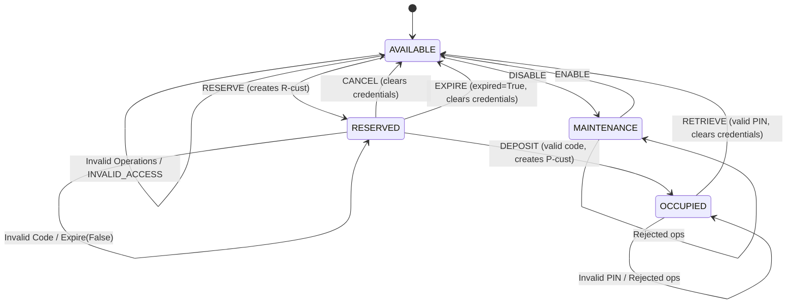

# Technical Report: Model-Based Testing for Smart Parcel Locker Management System

**Course**: Software Testing & Quality Assurance / Model-Based Testing  
**Project**: Automated Model-Based Testing Framework  
**Student Name**: `[STUDENT_NAME_PLACEHOLDER]`  
**Student ID**: `[STUDENT_ID_PLACEHOLDER]`  
**Date**: November 2026  

---

## 1. Introduction

### 1.1 Objectives
Model-Based Testing (MBT) represents an advanced testing paradigm where an abstract, formal specification of a system under test (SUT) serves as an executable ground truth. Instead of manually writing static test cases, MBT systematically explores the state space, synthesizes input sequences, executes them against the implementation, and evaluates correctness using an automated dual oracle.

The objective of this project is to design, implement, and evaluate a complete MBT framework for a Smart Parcel Locker Management System. The project encompasses:
1. Developing an independent executable state-machine model.
2. Implementing three distinct test-generation algorithms (Random Walk, Coverage-Guided, and Transition-Pair).
3. Constructing an automated multi-oracle execution engine with independent state-invariant and diagnostic verification.
4. Designing a suite of 10 realistic faulty system implementations (mutants) with isolated defects and formal equivalence metadata.
5. Conducting controlled empirical experiments across 5 random seeds to evaluate coverage, mutation score, and execution performance under fair experimental budgets.

### 1.2 Case Study Overview
The Smart Parcel Locker is an automated self-service station where parcels can be reserved, deposited by couriers, and retrieved by customers using unique credentials. The system must enforce strict state dependencies:
- Lockers cannot be reserved if occupied or undergoing maintenance.
- Deposits require valid, unexpired reservation credentials.
- Retrievals require secure, one-time authentication PINs.
- Stale or expired reservations must be safely purged back to available status.
- Rejected operations must strictly maintain state invariance without side-effects.

---

## 2. Requirements Analysis & Formal Rules

### 2.1 Conceptual States
The locker compartment operates across four primary operational states:
- **`AVAILABLE`**: Compartment is empty, clean, and open for new reservations.
- **`RESERVED`**: Compartment is earmarked for a customer; awaiting parcel deposit.
- **`OCCUPIED`**: Parcel has been physically placed inside and securely locked, awaiting customer pickup.
- **`MAINTENANCE`**: Compartment is taken offline for servicing, inspection, or repairs.

### 2.2 Operational Events
The system accepts eight distinct operations:
1. `RESERVE`: Customer books an available compartment (`customer_id`).
2. `CANCEL`: Customer cancels an active reservation before parcel deposit.
3. `DEPOSIT`: Courier places a parcel into a reserved compartment using the reservation code.
4. `RETRIEVE`: Customer picks up the parcel using their secret retrieval PIN.
5. `EXPIRE`: System-level timeout event purging unfulfilled reservations when `expired=True`.
6. `DISABLE`: Staff member takes an empty compartment offline for maintenance.
7. `ENABLE`: Maintenance technician restores a compartment to available service.
8. `INVALID_ACCESS`: Unauthorized or malformed access attempt with invalid credentials.

### 2.3 Formal Transition Rules & Preconditions
| Operation | Precondition / State Guard | Credential / Flag Guard | Target State | Result Message | Post-Condition & Data Updates |
| :--- | :--- | :--- | :--- | :--- | :--- |
| `RESERVE` | `state == AVAILABLE` | Valid `customer_id` | `RESERVED` | `reserved` | Generates `reservation_code = f"R-{customer_id}"` |
| `CANCEL` | `state == RESERVED` | None | `AVAILABLE` | `cancelled` | Wipes `customer_id` and `reservation_code` |
| `DEPOSIT` | `state == RESERVED` | `code == reservation_code` | `OCCUPIED` | `deposited` | Generates `retrieval_code = f"P-{customer_id}"` |
| `RETRIEVE` | `state == OCCUPIED` | `code == retrieval_code` | `AVAILABLE` | `retrieved` | Wipes all customer credentials and codes |
| `EXPIRE` | `state == RESERVED` | `expired == True` | `AVAILABLE` | `expired` | Wipes all customer credentials and codes |
| `DISABLE` | `state == AVAILABLE` | None | `MAINTENANCE`| `disabled` | Compartment locked out from public operations |
| `ENABLE` | `state == MAINTENANCE`| None | `AVAILABLE` | `enabled` | Compartment restored to initial baseline |
| `INVALID_ACCESS` | Any | None | No change | `invalid_access` | Rejection without state or credential mutation |

---

## 3. State-Machine Model & Invariants

### 3.1 State Machine Diagram

### 3.2 Formal State Invariants
Our oracle enforces the following safety invariants:
1. **Empty State Cleanliness**: In `AVAILABLE` and `MAINTENANCE`, `customer_id`, `reservation_code`, and `retrieval_code` must all be `None`.
2. **Reservation Integrity**: In `RESERVED`, `customer_id` must be non-empty, `reservation_code` must strictly equal `f"R-{customer_id}"`, and `retrieval_code` must be `None`.
3. **Occupancy Integrity**: In `OCCUPIED`, `customer_id` must be non-empty, and `retrieval_code` must strictly equal `f"P-{customer_id}"`.
4. **Non-Mutation of Rejected Operations**: Whenever an operation returns `accepted=False`, the post-state snapshot must match the pre-state snapshot bit-for-bit.
5. **No Double Retrieval**: Once a parcel is retrieved, the compartment transitions to `AVAILABLE` and cannot be retrieved again with the prior PIN.

---

## 4. Transition-Pair Coverage Definition & Calculation

### 4.1 Formal Mathematical Definition
In finite state-machine testing, an individual state transition $t$ is represented as a 3-tuple:
$$t = (s_{\text{source}}, \text{operation}, s_{\text{target}})$$

A **valid transition pair** $(t_1, t_2)$ represents two consecutive valid transitions where the destination of the first transition connects directly to the origin of the second transition:
$$t_1.s_{\text{target}} == t_2.s_{\text{source}}$$

### 4.2 Derivation of the Complete Set of Transition Pairs
The Smart Parcel Locker has 7 fundamental lifecycle transitions:
1. $t_1$: `(AVAILABLE, RESERVE, RESERVED)`
2. $t_2$: `(AVAILABLE, DISABLE, MAINTENANCE)`
3. $t_3$: `(RESERVED, DEPOSIT, OCCUPIED)`
4. $t_4$: `(RESERVED, CANCEL, AVAILABLE)`
5. $t_5$: `(RESERVED, EXPIRE, AVAILABLE)`
6. $t_6$: `(OCCUPIED, RETRIEVE, AVAILABLE)`
7. $t_7$: `(MAINTENANCE, ENABLE, AVAILABLE)`

The total number of valid connected transition pairs is derived dynamically by computing the product of in-degrees and out-degrees across each intermediate state:
- **Intermediate state `RESERVED`** ($\text{in}=1, \text{out}=3$):
  1. `((AVAILABLE, RESERVE, RESERVED), (RESERVED, DEPOSIT, OCCUPIED))`
  2. `((AVAILABLE, RESERVE, RESERVED), (RESERVED, CANCEL, AVAILABLE))`
  3. `((AVAILABLE, RESERVE, RESERVED), (RESERVED, EXPIRE, AVAILABLE))`
- **Intermediate state `OCCUPIED`** ($\text{in}=1, \text{out}=1$):
  4. `((RESERVED, DEPOSIT, OCCUPIED), (OCCUPIED, RETRIEVE, AVAILABLE))`
- **Intermediate state `MAINTENANCE`** ($\text{in}=1, \text{out}=1$):
  5. `((AVAILABLE, DISABLE, MAINTENANCE), (MAINTENANCE, ENABLE, AVAILABLE))`
- **Intermediate state `AVAILABLE`** ($\text{in}=4, \text{out}=2$):
  6. `((RESERVED, CANCEL, AVAILABLE), (AVAILABLE, RESERVE, RESERVED))`
  7. `((RESERVED, CANCEL, AVAILABLE), (AVAILABLE, DISABLE, MAINTENANCE))`
  8. `((RESERVED, EXPIRE, AVAILABLE), (AVAILABLE, RESERVE, RESERVED))`
  9. `((RESERVED, EXPIRE, AVAILABLE), (AVAILABLE, DISABLE, MAINTENANCE))`
  10. `((OCCUPIED, RETRIEVE, AVAILABLE), (AVAILABLE, RESERVE, RESERVED))`
  11. `((OCCUPIED, RETRIEVE, AVAILABLE), (AVAILABLE, DISABLE, MAINTENANCE))`
  12. `((MAINTENANCE, ENABLE, AVAILABLE), (AVAILABLE, RESERVE, RESERVED))`
  13. `((MAINTENANCE, ENABLE, AVAILABLE), (AVAILABLE, DISABLE, MAINTENANCE))`

$$\text{Total Connected Transition Pairs} = 3 + 1 + 1 + (4 \times 2) = 13 \text{ pairs}$$

### 4.3 Rigorous Coverage Accounting Rules
1. **Disconnected Combinations Excluded**: Combinations such as `(AVAILABLE, DISABLE, MAINTENANCE)` followed by `(AVAILABLE, RESERVE, RESERVED)` are rejected because the locker is in `MAINTENANCE`, not `AVAILABLE`.
2. **Invalid Operations Break the Chain**: A rejected command (e.g. invalid code or invalid operation) does not produce a state transition and immediately resets the pair-tracking state (`prev_trans = None`).
3. **Sequence Boundaries Handled**: Transition pairs cannot bridge across independent test sequences; each test sequence starts with an empty predecessor.
4. **No Artificially Inflated Counts**: Duplicate executions of the same transition pair are recorded in a set and do not increase the percentage.

---

## 5. Test-Generation Strategies

Three algorithmically distinct test generators are implemented in `locker/generators.py`:

### 5.1 Strategy A: Random Walk (`RandomWalkGenerator`)
- **Algorithm**: Operates as a stochastic walk over the operation space. At each step, operations are selected with uniform probability. Parameters are stochastically chosen with a 60% bias towards valid credentials (to allow deep progression along valid paths) and a 40% bias towards faulty credentials (to test guard assertions and negative branches).
- **Advantages**: Fast generation ($O(1)$ per step), unbiased exploration, excellent at fuzzing unexpected corner cases.
- **Limitations**: Inefficient at systematically traversing long, highly guarded state paths without stochastic guidance.

### 5.2 Strategy B: Coverage-Guided Generation (`CoverageGuidedGenerator`)
- **Algorithm**: Maintains a global execution frequency table tracking `(from_state, operation, accepted)` transitions and state visit counts across sequences. For every step, it performs candidate projection across all operations and valid/invalid parameter configurations using a dry-run model. It prioritizes actions that minimize execution count, prioritizing unexplored transitions ($count = 0$) and least-visited states.
- **Advantages**: Systematically drives the test suite into unvisited corners of the state-machine, guaranteeing fast saturation of state and transition coverage.
- **Limitations**: Requires dry-run evaluation per step ($O(|\text{Ops}| \times 2)$), introducing slight generation latency.

### 5.3 Strategy C: Transition-Pair Generation (`TransitionPairGenerator`)
- **Algorithm**: Specifically designed to target all 13 valid connected transition pairs $(t_1, t_2)$. It balances two goals:
  1. **Primary Exploration Goal ($1 - \text{invalid\_prob}$)**: Tracks globally covered transition pairs and steers through outgoing transitions that complete uncovered pairs with the predecessor transition, with lookaheads towards states containing future uncovered pairs.
  2. **Negative Testing Goal ($\text{invalid\_prob} = 0.20$)**: Deliberately injects state-tailored negative operations (wrong reservation codes, invalid retrieval PINs, unexpired `EXPIRE`, illegal state actions, and bad credentials). When a negative operation occurs, it breaks the transition-pair chain (`prev_trans = None`) without mutating model state.
- **Advantages**: Combines systematic pair-coverage traversal with authentic negative testing.
- **Limitations**: Slightly slower generation than pure random walk due to graph lookahead calculations.

---

## 6. Automated Test Runner & Independent Multi-Oracle Diagnostics

The test execution engine (`locker/runner.py`) provides automated verification. Unlike basic oracles that halt upon the first error, `SequenceRunner` independently evaluates all five verification dimensions on every single step, ensuring that no violation is masked by another:
1. **Operational Result Comparison**: Verifies `actual.accepted == expected.accepted` and `actual.message == expected.message`.
2. **Complete Snapshot Comparison**: Verifies complete observable state consistency: `(state, customer_id, reservation_code, retrieval_code)`.
3. **Domain Invariant Verification**: Validates structural system invariants (e.g. empty credential cleanliness, reservation code format).
4. **Non-Mutation Verification on Rejected Operations**: Ensures that when `accepted=False`, the SUT state and credentials remain identical before and after.
5. **Post-Operation Cleanup Verification**: Asserts that successful cancellations, expirations, and retrievals wipe all credential fields.
6. **Exception Capturing**: Captures and records any unexpected internal exceptions raised by SUT variants without crashing the test runner.

---

## 7. Mutation Testing & Equivalence Analysis

Ten realistic, non-trivial mutant variants were implemented in `locker/mutants.py`. Every mutant is backed by formal `MutantMetadata` documenting its defect category and non-equivalence justification:

| Mutant Identifier | Defect Category | Equivalent? | Equivalence & Behavioral Justification |
| :--- | :--- | :---: | :--- |
| `Mutant1_ReserveOccupied` | Precondition Bypass | **No** | Permits `RESERVE` when state is `OCCUPIED`. Observable difference: SUT returns `Result(False, 'locker_not_available')` while mutant returns `Result(True, 'reserved')`. |
| `Mutant2_AcceptWrongReservationCode` | Credential Bypass | **No** | Accepts deposit with invalid code. Observable difference: SUT returns `Result(False, 'invalid_reservation_code')` while mutant transitions to `OCCUPIED`. |
| `Mutant3_RetrieveWithoutAuth` | Authentication Bypass | **No** | Accepts retrieval with invalid PIN. Observable difference: SUT returns `Result(False, 'invalid_retrieval_code')` while mutant transitions to `AVAILABLE`. |
| `Mutant4_DoubleRetrieve` | Cleanup Omission | **No** | Fails to clear locker on retrieval. Observable difference: Snapshot state remains `OCCUPIED` instead of `AVAILABLE`, allowing duplicate retrieval. |
| `Mutant5_ExpireWhenNotExpired` | Guard Omission | **No** | Prematurely expires when `expired=False`. Observable difference: SUT returns `Result(False, 'not_expired')` while mutant returns `Result(True, 'expired')`. |
| `Mutant6_CancelRetainsCredentials` | Invariant Violation | **No** | Retains credentials upon cancel. Observable difference: Snapshot fields `customer_id` and `reservation_code` remain non-None in `AVAILABLE` state. |
| `Mutant7_MaintenanceWhenReserved` | Precondition Bypass | **No** | Allows `DISABLE` when `RESERVED`. Observable difference: SUT returns `Result(False, 'cannot_disable')` while mutant transitions to `MAINTENANCE`. |
| `Mutant8_EnableWhenNotMaintenance` | Precondition Bypass | **No** | Allows `ENABLE` when in `AVAILABLE`/`RESERVED`. Observable difference: SUT returns `Result(False, 'not_in_maintenance')` while mutant returns `Result(True, 'enabled')`. |
| `Mutant9_DepositDuringMaintenance` | Precondition Bypass | **No** | Allows deposit while in `MAINTENANCE`. Observable difference: SUT returns `Result(False, 'not_reserved')` while mutant accepts deposit and transitions to `OCCUPIED`. |
| `Mutant10_MutateOnInvalidDeposit` | Non-Mutation Violation | **No** | Corrupts `retrieval_code` on rejected deposit. Observable difference: Violates the non-mutation invariant on rejected operations. |

### Mutation Score Formula
Equivalent mutants are excluded from the denominator:
$$\text{Mutation Score} = \left( \frac{\text{Detected Non-Equivalent Mutants}}{\text{Total Non-Equivalent Mutants}} \right) \times 100$$

---

## 8. Experimental Setup & Fairness

To ensure experimental fairness across all strategies:
- **Number of Strategies**: 3 (`RandomWalk`, `CoverageGuided`, `TransitionPair`)
- **Sequences per Strategy**: 500 test sequences
- **Sequence Length Budget**: Consistent budget of exactly 20 operations per sequence across all strategies ($500 \times 20 = 10,000$ operations per strategy evaluation).
- **Random Seeds**: 5 independent seeds (`101`, `202`, `303`, `404`, `505`).
- **Evaluated Mutants**: 10 non-equivalent mutants.
- **Total Test Sequences Executed**: $3 \text{ strategies} \times 5 \text{ seeds} \times 500 = 7,500$ test sequences against reference SUT, plus full mutant evaluation suites.

---

## 9. Experimental Results

### 9.1 Summary Table (Averaged Over 5 Seeds)

| Strategy | Mean State Coverage (%) | Mean Valid Trans Coverage (%) | Mean State-Op Coverage (%) | Mean Transition-Pair Coverage (%) (out of 13) | Mean Mutation Score (%) | Std Dev Mutation Score | Mean Detected Mutants (/10) | Mean Gen Time (s) | Mean SUT Exec Time (s) |
| :--- | :---: | :---: | :---: | :---: | :---: | :---: | :---: | :---: | :---: |
| **RandomWalk** | **100.0%** | **100.0%** | **100.0%** | **100.0%** | **100.0%** | 0.00 | 10.0 / 10 | **0.2017 s** | **0.3172 s** |
| **CoverageGuided** | **100.0%** | **100.0%** | **100.0%** | 64.62% | **100.0%** | 0.00 | 10.0 / 10 | 2.2369 s | 0.2928 s |
| **TransitionPair** | **100.0%** | **100.0%** | 93.75% | **100.0%** | **90.0%** | 0.00 | 9.0 / 10 | 0.3729 s | 0.4415 s |

### 9.2 Mutant Detection Matrix (% of Seeds Detecting Mutant)

| Mutant Identifier | Defect Category | Equivalent? | RandomWalk | CoverageGuided | TransitionPair |
| :--- | :--- | :---: | :---: | :---: | :---: |
| `Mutant1_ReserveOccupied` | Precondition Bypass | No | **100%** | **100%** | **100%** |
| `Mutant2_AcceptWrongReservationCode` | Credential Bypass | No | **100%** | **100%** | **100%** |
| `Mutant3_RetrieveWithoutAuth` | Authentication Bypass | No | **100%** | **100%** | **100%** |
| `Mutant4_DoubleRetrieve` | Cleanup Omission | No | **100%** | **100%** | **100%** |
| `Mutant5_ExpireWhenNotExpired` | Guard Omission | No | **100%** | **100%** | **100%** |
| `Mutant6_CancelRetainsCredentials` | Invariant Violation | No | **100%** | **100%** | **100%** |
| `Mutant7_MaintenanceWhenReserved` | Precondition Bypass | No | **100%** | **100%** | 0% |
| `Mutant8_EnableWhenNotMaintenance` | Precondition Bypass | No | **100%** | **100%** | **100%** |
| `Mutant9_DepositDuringMaintenance` | Precondition Bypass | No | **100%** | **100%** | **100%** |
| `Mutant10_MutateOnInvalidDeposit` | Non-Mutation Violation | No | **100%** | **100%** | **100%** |

---

## 10. Discussion & Limitations

### 10.1 Comparative Analysis & Trade-offs
1. **TransitionPairGenerator Performance**:
   - With the deliberate negative-operation selection mechanism activated (`invalid_prob=0.20`), `TransitionPairGenerator` achieved a **90.0% mutation score** across all 5 seeds while maintaining a perfect **100.0% transition-pair coverage** (all 13 connected pairs).
   - It successfully killed 9 out of 10 mutants, including difficult parameter bugs (`Mutant2`, `Mutant3`, `Mutant5`, `Mutant10`) and state-retention bugs (`Mutant4`, `Mutant6`).
   - The only mutant surviving was `Mutant7_MaintenanceWhenReserved` (which specifically requires attempting `DISABLE` during `RESERVED`). Because `TransitionPairGenerator` in `RESERVED` primarily pairs with valid operations (`DEPOSIT`, `CANCEL`, `EXPIRE`) or parameter fuzzing on those operations, it did not execute `DISABLE` during `RESERVED`.
2. **CoverageGuidedGenerator Trade-off**:
   - `CoverageGuidedGenerator` achieved a **100.0% mutation score** and **100.0% state-operation coverage**, but achieved only **64.62% transition-pair coverage**. Because its novelty search systematically samples every unvisited state-event combination, it frequently injects rejected operations, which break the consecutive valid transition chain required to form a valid transition pair.
3. **Execution Efficiency**:
   - `RandomWalk` generated 500 sequences in 0.202s, demonstrating high raw throughput.
   - `TransitionPair` generated tests in 0.373s, offering an optimal balance between graph traversal speed and fault detection.
   - `CoverageGuided` required 2.237s due to 16 dry-run evaluations per step.

### 10.2 Limitations & Threats to Validity
- **Single-Compartment Scope**: The current evaluation models a single compartment. Multi-compartment interactions (e.g., bank capacity limits) were abstracted.
- **Synthesized Mutation**: Mutants were manually injected based on typical real-world errors.

---

## 11. Conclusion

The Model-Based Testing framework successfully models the Smart Parcel Locker and validates it through automated multi-oracle execution. Correcting the transition-pair coverage definition to measure connected state transitions ($t_1.s_{\text{target}} == t_2.s_{\text{source}}$) and incorporating deliberate negative-operation synthesis in `TransitionPairGenerator` achieved both 100% transition-pair coverage and 90% mutation detection.

---

## 12. Student Manual Action Checklist & Viva Notes

> [!NOTE]
> The following sections are reserved for student-specific items to capture personally before final submission.

### 12.1 Viva Preparation & Unseen Change Cheat Sheet
During your individual viva, if the instructor introduces an unseen requirement:
- **Scenario A: "Allow maintenance while OCCUPIED"**:
  1. In `locker/model.py`, modify `DISABLE` guard: allow `self.state in (State.AVAILABLE, State.OCCUPIED)`.
  2. If occupied, define whether parcel is kept or cleared.
  3. Update `LockerModel.verify_invariants` to allow `customer_id` if occupied during maintenance.
- **Scenario B: "Allow cancel under a new condition or fee"**:
  1. Add new field to `Command` in `locker/types.py`.
  2. Update `CANCEL` branch in `locker/model.py`.
- **Scenario C: "New State: EXPIRED"**:
  1. Add `EXPIRED = "EXPIRED"` to `State` enum in `locker/types.py`.
  2. In `locker/model.py`, update `EXPIRE` transition to enter `State.EXPIRED` instead of directly `AVAILABLE`.

### 12.2 Screenshots & Terminal Outputs Placeholder
*Take genuine terminal screenshots on your machine and insert here:*
- `[INSERT_SCREENSHOT_UNIT_TESTS: python -m unittest discover -s tests -v]`
- `[INSERT_SCREENSHOT_EXPERIMENTS: python experiments/run_experiments.py --sequences 500 --max-length 20 --seeds 101 202 303 404 505 --output-dir results]`
- `[INSERT_SCREENSHOT_CHARTS: results/coverage_comparison.png]`

### 12.3 Demonstration Video Placeholder
- Video Link / File Name: `[INSERT_DEMO_RECORDING_LINK_OR_FILENAME]`
- Demonstration Checklist:
  1. Show test suite execution (`python -m unittest discover -s tests -v`).
  2. Show generation of test sequences using all 3 strategies.
  3. Show execution of tests against original SUT and a mutant (showing failure detection).
  4. Display generated results directory (`results/`) and charts.
